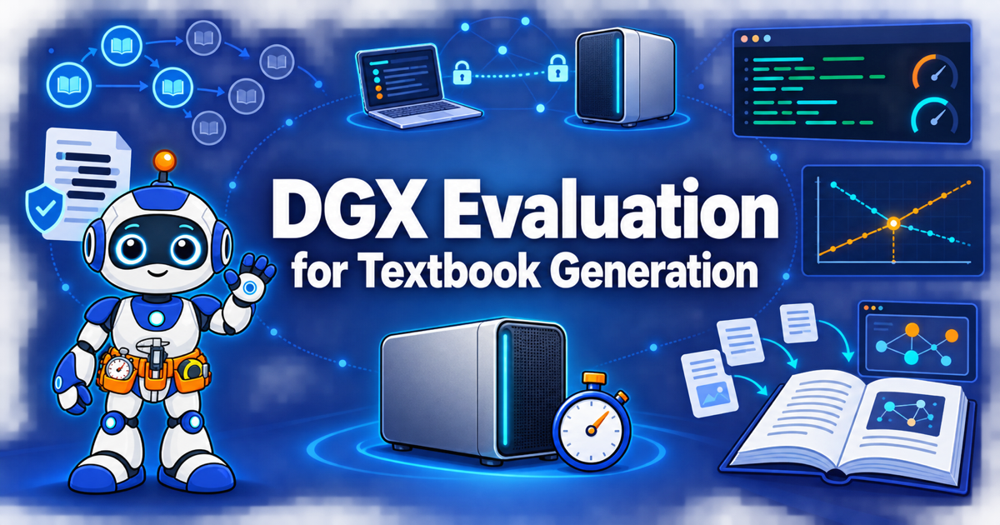

# DGX Evaluation for Textbook Generation

<figure markdown>
  { width="100%" }
</figure>

!!! mascot-welcome "Welcome to the evaluation"
    { class="mascot-admonition-img" }
    I'm Tera, and I'll guide you through the measurements. Most people settle whether a local model can write a textbook with an opinion, and you are about to settle it with numbers from a real DGX. **Measure first, then decide!**

## The Question

Intelligent textbooks are usually generated by cloud-hosted frontier models.
This book asks whether one NVIDIA DGX system, running an open-weight small
language model, can generate the same kind of interactive textbook from start
to finish without sending a token to the cloud.

It teaches how to answer that question with measurements instead of opinions.
You reach the machine, verify its hardware with Python probes, choose and serve
a model, run the textbook-generation skills against it, and score what comes
out. Every step ends with a test, so a failure is caught where it happens and
not three layers later.

## Where the Evaluation Stands

The benchmark asks each model to write an Algebra I textbook in three stages: a
learning graph, a chapter structure, and the chapter text. Ten open-weight
models were chosen for one DGX with 128 GB of unified memory.

- Six of the ten produced a learning graph, and all six ran through all three
  stages.
- Two of those six, `nemotron-3.5-lightning:30b` and `qwen3.6:35b`, wrote every
  chapter they had designed. The other four stopped short, and `qwen3.8:27b`
  was too slow to write a single chapter.
- Four models produced no learning graph.

!!! warning "Generated text, not yet judged"

    The books are shown as each model wrote them. No person has yet judged
    whether the content is correct, so a chapter count measures how far a model
    got, not how well it taught. Every test has run once, and no cloud-generated
    baseline exists yet.

[Model Results](models/index.md) holds what each model produced, and
[Evaluation Status](appendices/evaluation-status.md) tracks the stages each one
has finished. These figures are from October 10, 2026.

## The Book at a Glance

| Item | Count | What it is |
|---|---:|---|
| Chapters | 23 | The steps of a real evaluation, from the question to a sanitized report |
| Concepts | 506 | Ideas in the [learning graph](learning-graph/index.md), linked by 824 dependencies |
| MicroSims | 36 | Small interactive exercises, each on one concept |
| Glossary terms | 506 | One [definition](glossary.md) for every concept in the learning graph |
| Quiz questions | 230 | Ten multiple-choice questions at the end of every chapter |
| Annotated references | 230 | Ten sources per chapter, each with a note on why it matters |
| Candidate models | 10 | Open-weight models chosen for the DGX, six of which have results |
| Chapter text | about 100,000 words | Written in dependency order, so no concept appears before its prerequisites |

## What the Chapters Cover

| Chapters | Theme | What you do |
|---|---|---|
| 1-2 | The target | Learn what an intelligent textbook is and the rules a generated one must follow |
| 3-6 | The decision | Weigh small models against cloud services, learn the DGX hardware, and separate cost, price, and quality |
| 7-10 | The machine | Reach the DGX over a private mesh network, build a conda environment, take an inventory, and probe the hardware |
| 11-15 | The model | Size a model to fit in memory, select and download candidates, serve one locally, and tune it |
| 16-18 | The harness | Follow the agent loop, install skills, connect a harness to the local model, and contain it in a sandbox |
| 19-23 | The evaluation | Design a fair test, score and diagnose runs, report the cost per textbook, and sanitize before publishing |

The [list of chapters](chapters/index.md) summarizes all 23.

## Who This Book Is For

AI and machine-learning engineers, instructional technologists, technical
authors, and IT infrastructure leads who must decide whether a local DGX can
replace or supplement cloud AI services for generating textbooks.

You need:

- Comfort with a Linux or macOS command line, including editing files and using SSH
- Basic Python: reading a script, running it, and installing a package
- Basic git and GitHub: clone, commit, and push
- Hands-on experience with at least one generative AI chat or coding assistant

No experience with GPU administration, model serving, or model training is
required.

!!! warning "Every address in this book is a placeholder"

    The DGX in this evaluation is a real machine on a private network, and this
    site is public. Examples use placeholders such as `<dgx-host>` and
    `<user>`, and sample output has been edited by hand. [Chapter 23](chapters/23-sanitizing-and-publishing/index.md)
    teaches how to sanitize probe reports, logs, and screenshots before sharing
    them.

## Explore the Book

-   **[Chapters](chapters/index.md)**

    Twenty-three chapters, each with a quiz and annotated references.

-   **[Model Results](models/index.md)**

    The learning graph, chapters, and metrics that each candidate model produced.

-   **[MicroSims](sims/index.md)**

    Interactive exercises you can run in the browser as you read.

-   **[Learning Graph](learning-graph/index.md)**

    How the 506 concepts depend on each other, with an interactive viewer.

-   **[Appendices](appendices/index.md)**

    The setup steps, testing architecture, design choices, cost analysis, and evaluation status.

-   **[Glossary](glossary.md)**

    Definitions, with an example and related terms, for every concept in the book.

## Getting Started

Read the chapters in order if you are building your own evaluation, starting
with [Chapter 1: Prerequisites and the Intelligent Textbook](chapters/01-intro-intelligent-textbooks/index.md).

Start somewhere else if you already know part of the path:

- To weigh a local model against a cloud service, go to
  [Chapter 4](chapters/04-local-versus-cloud/index.md).
- To check a machine before you install anything, go to
  [Chapter 10](chapters/10-hardware-probes/index.md).
- To design a fair comparison, go to
  [Chapter 19](chapters/19-fair-evaluation-design/index.md).
- To see what the models wrote, go straight to [Model Results](models/index.md).
